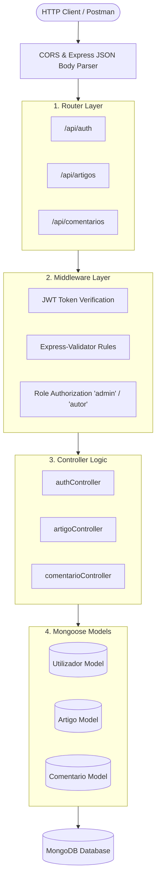
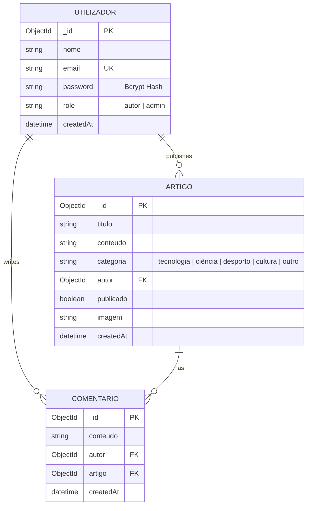

# 📝 Blog Platform API

<p align="center">
  
  
  
  
  
  
</p>

> A RESTful blogging API built with **Node.js**, **Express**, and **MongoDB (Mongoose)**. It provides user authentication, role-based access control (Author and Admin), paginated articles with category filters, and comments.

---

## ⚡ Architecture & Request Flow



---

## 📊 Database Schema (ERD)



---

## ✨ Features

* **Authentication & RBAC:** User registration, password hashing with bcrypt, JWT token authentication, and role authorization (`autor` vs `admin`). Authors manage their own articles/comments; administrators have platform-wide moderation rights.
* **Articles CRUD & Filtering:** Create, read, update, and delete articles with pagination (`page`, `limit`) and category filtering (`?categoria=tecnologia`).
* **Comments:** Add and delete comments linked to specific articles.
* **Validation & Error Handling:** Input validation via `express-validator` and centralized middleware handling invalid IDs (`CastError`) and duplicate keys (`code: 11000`).
* **Route Aliases:** Endpoints accessible in Portuguese (`/api/artigos`, `/api/comentarios`) and English (`/api/posts`, `/api/comments`).
* **Postman Collection:** Ready-to-use requests with automated JWT token handling.

---

## 📑 API Endpoints Reference

### 🔐 Authentication (`/api/auth`)

| Method | Endpoint | Access | Description |
| :--- | :--- | :--- | :--- |
| `POST` | `/api/auth/register` | Public | Register a new user |
| `POST` | `/api/auth/login` | Public | Login and receive JWT token |
| `GET` | `/api/auth/me` | 🔒 Authenticated | Retrieve current user profile |

### 📰 Articles (`/api/artigos` or `/api/posts`)

| Method | Endpoint | Access | Description |
| :--- | :--- | :--- | :--- |
| `GET` | `/api/artigos` | Public | List published articles (`?page=1&limit=10&categoria=tecnologia`) |
| `GET` | `/api/artigos/:id` | Public | Get single article by ID |
| `POST` | `/api/artigos` | 🔒 Authenticated | Publish a new article |
| `PUT` | `/api/artigos/:id` | 🔒 Author / Admin | Update article |
| `DELETE` | `/api/artigos/:id` | 🔒 Author / Admin | Delete article |

### 💬 Comments (`/api/artigos/:artigoId/comentarios` & `/api/comentarios`)

| Method | Endpoint | Access | Description |
| :--- | :--- | :--- | :--- |
| `GET` | `/api/artigos/:artigoId/comentarios` | Public | List all comments for an article |
| `POST` | `/api/artigos/:artigoId/comentarios` | 🔒 Authenticated | Add a comment to an article |
| `DELETE` | `/api/comentarios/:id` | 🔒 Author / Admin | Delete a comment |

---

## 🛠️ Getting Started

### Prerequisites
* **Node.js** v20+
* **MongoDB** (Local instance or MongoDB Atlas)

### 1. Clone the repository
```bash
git clone https://github.com/Afonsojlc/blog-api.git
cd blog-api
```

### 2. Install dependencies
```bash
npm install
```

### 3. Environment configuration
Copy `.env.example` to `.env`:
```bash
cp .env.example .env
```

Configure your `.env` variables:
```env
PORT=3000
MONGODB_URI="mongodb://localhost:27017/blog_db"
JWT_SECRET="your_jwt_secret_key"
JWT_EXPIRES_IN="7d"
```

### 4. Run the server
```bash
# Development (with auto-reload)
npm run dev

# Production
npm start
```
The server will start at `http://localhost:3000`.

---

## 📬 Testing with Postman

A pre-configured Postman collection is included: [`blog-api.postman_collection.json`](blog-api.postman_collection.json).

1. Import `blog-api.postman_collection.json` into Postman.
2. Run the **Login User** request.
3. The test script automatically stores the returned JWT token into the `{{token}}` collection variable.
4. Protected requests will use this token automatically.

---

## 📁 Project Structure

```text
blog-api/
├── src/
│   ├── config/
│   │   └── db.js                 # MongoDB connection
│   ├── controllers/
│   │   ├── artigoController.js   # Article CRUD & pagination
│   │   ├── authController.js     # User registration & login
│   │   └── comentarioController.js # Comment operations
│   ├── middleware/
│   │   ├── auth.js               # JWT verification & role authorization
│   │   ├── errorHandler.js       # Centralized error handler
│   │   └── validar.js            # Input validation helper
│   ├── models/
│   │   ├── Artigo.js             # Article Mongoose schema
│   │   ├── Comentario.js         # Comment Mongoose schema
│   │   └── Utilizador.js         # User schema with bcrypt pre-save hook
│   ├── routes/
│   │   ├── artigos.js            # Article routes
│   │   ├── auth.js               # Auth routes
│   │   └── comentarios.js        # Comment routes
│   └── app.js                    # Express app initialization
├── .env.example
├── .gitignore
├── blog-api.postman_collection.json
├── package.json
└── README.md
```

---

## 👤 Author

**Afonso Carvalho**  
* GitHub: [@Afonsojlc](https://github.com/Afonsojlc)  
* LinkedIn: [Afonso Carvalho](https://www.linkedin.com/in/afonso-carvalho-64796328a/)

---

## 📄 License

This project is licensed under the [MIT License](LICENSE).
